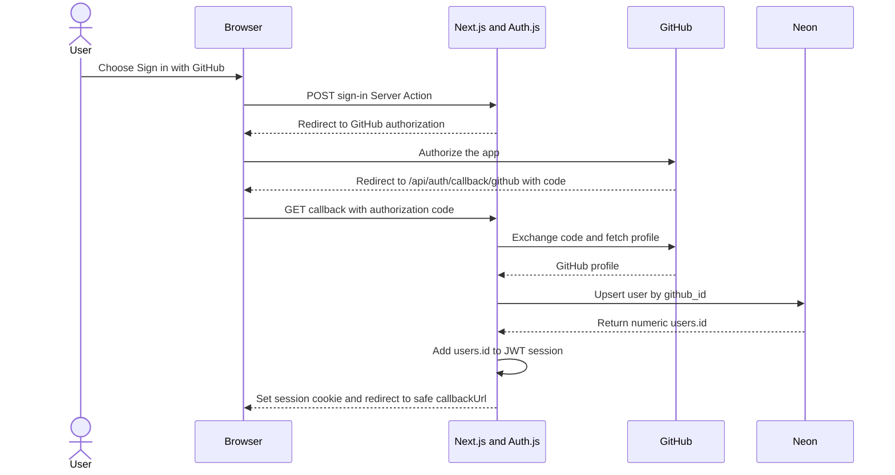

# Project Tracker

A Next.js project and task tracker backed by Neon Postgres.

## Features

- Create and delete projects and tasks.
- View project progress and manage tasks on a three-column Kanban board.
- Move tasks between To do, Doing, and Done with optimistic updates.
- Filter tasks by priority and search titles.
- See overall task statistics, per-project completion, and overdue tasks.

## Stack

- Next.js App Router with React Server and Client Components
- TypeScript and Tailwind CSS
- Neon Postgres via `@neondatabase/serverless`
- Zod for validating form input and database rows

## Architecture

Read paths are implemented as Server Components that call typed functions in
`src/lib/queries.ts`; those functions execute parameterized tagged-template
queries through the Neon client in `src/lib/db.ts`. Server Components render
project pages, Kanban data, and SQL-aggregated statistics.

Writes go through Server Actions in `src/app/actions.ts`. Actions validate
untrusted `FormData` with Zod, execute parameterized INSERT/UPDATE/DELETE
statements, and revalidate affected routes. Client forms use `useActionState`,
and the Kanban board uses `useOptimistic` for status changes.

## Setup

1. Create a Neon project at [neon.tech](https://neon.tech), then create a
   database and copy its connection string.
2. Create `.env.local` from the example:

   ```powershell
   Copy-Item .env.example .env.local
   ```

3. Set `DATABASE_URL`, `AUTH_SECRET`, `AUTH_GITHUB_ID`, and
   `AUTH_GITHUB_SECRET` in `.env.local`. Register
   `http://localhost:3000/api/auth/callback/github` as the GitHub OAuth
   callback URL. Keep credentials private and do not commit `.env.local`.
4. Create the tables using the schema below.
5. Install dependencies and start the development server:

   ```powershell
   npm install
   npm run dev
   ```

   Open [http://localhost:3000](http://localhost:3000).

Run checks with `npm run lint` and `npm run build`. A valid `DATABASE_URL` must
be present when running the app.

## Authentication

GitHub sign-in is handled by Auth.js. Middleware redirects unauthenticated
requests to `/login` and saves the requested path as `callbackUrl`. The login
page only accepts a relative callback path to prevent open redirects.

### Environment variables

| Variable | Description |
|---|---|
| `DATABASE_URL` | Neon Postgres connection string |
| `AUTH_SECRET` | Secret used by Auth.js to sign and encrypt session data |
| `AUTH_GITHUB_ID` | GitHub OAuth App client ID |
| `AUTH_GITHUB_SECRET` | GitHub OAuth App client secret |

Keep the values in `.env.local` private and never commit real credentials.

### Create a GitHub OAuth App

1. Open [GitHub Developer settings](https://github.com/settings/developers) and
   choose **OAuth Apps** → **New OAuth App**.
2. Enter an application name and set the homepage URL to
   `http://localhost:3000`.
3. Set the authorization callback URL to
   `http://localhost:3000/api/auth/callback/github`, then register the app.
4. Copy the app's client ID into `AUTH_GITHUB_ID` and generate a client secret
   for `AUTH_GITHUB_SECRET` in `.env.local`.
5. Generate `AUTH_SECRET` with `npx auth secret` or another cryptographically
   secure random generator. For deployment, configure the production domain
   and callback URL in the OAuth app and set the same environment variables in
   the hosting provider.

### OAuth flow



Pages and data-changing Server Actions also call `requireUser()` themselves.
Middleware is a useful first gate, but it is not an authorization boundary for
Server Actions: actions can be invoked directly, outside the expected page
navigation flow. Checking the session again at the server entry point ensures
each read or mutation has an authenticated user ID; database queries also
scope projects to that owner.

## Database schema

The application expects a `projects` table and a `tasks` table with the
following columns and constraints:

```sql
CREATE TABLE users (
  id SERIAL PRIMARY KEY,
  github_id TEXT NOT NULL UNIQUE,
  name TEXT,
  email TEXT,
  image TEXT
);

CREATE TABLE projects (
  id SERIAL PRIMARY KEY,
  name TEXT NOT NULL,
  description TEXT,
  color TEXT NOT NULL,
  owner_id INTEGER NOT NULL REFERENCES users(id) ON DELETE CASCADE,
  created_at TIMESTAMPTZ NOT NULL DEFAULT NOW()
);

CREATE TABLE tasks (
  id SERIAL PRIMARY KEY,
  project_id INTEGER NOT NULL REFERENCES projects(id) ON DELETE CASCADE,
  title TEXT NOT NULL,
  status TEXT NOT NULL CHECK (status IN ('todo', 'doing', 'done')),
  priority TEXT NOT NULL CHECK (priority IN ('low', 'medium', 'high')),
  due_date DATE,
  created_at TIMESTAMPTZ NOT NULL DEFAULT NOW()
);
```

`src/lib/queries.ts` contains the SELECT queries and aggregate statistics.
`src/app/actions.ts` contains the validated writes.

For an existing database with ownerless projects, run this one-off backfill
before enforcing `owner_id NOT NULL`. Replace the value with the GitHub account
ID returned by GitHub OAuth (not the OAuth application's client ID):

```sql
UPDATE projects AS p
SET owner_id = u.id
FROM users AS u
WHERE p.owner_id IS NULL
  AND u.github_id = '<YOUR_GITHUB_ACCOUNT_ID>';
```
